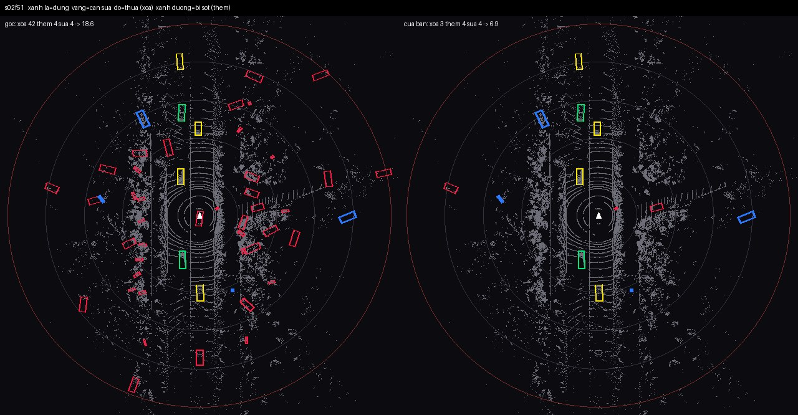

# Báo cáo Day 14 — Nguyễn Quốc Thắng — 2A202603158

- Mã học viên dùng với `--student`: `2A202603158`
- `seed_tag` trong `frames_A.txt`: `393590736f`
- Tập A: `s02f51`, `s03f43`, `s05f27`. Tập B: `s01f13 s01f31 s01f56 s03f06 s03f33 s03f53 s04f04 s04f26 s04f54 s05f00 s05f15 s05f43`.

## 1. Dự đoán trước sweep (bước 5b)

Viết trước khi chạy `scripts/pp_sweep.py`, chỉ dựa trên ảnh BEV/camera trong `png_A/` và số đo bước 5 của cấu hình gốc trên tập A: **xóa 80, thêm 18, sửa 23 → chi phí 53,5** (GT 48 hộp, dự đoán 110 hộp, khớp 30).

- **Tham số tôi nghĩ giảm công sửa nhiều nhất: `score_thr`, tăng từ 0,1 lên khoảng 0,4–0,5.** `min_points` gần như không giúp.
- **Vì sao.** Tập A thừa hộp nhiều hơn hẳn thiếu hộp. 80/110 hộp phải xóa, tốn 24 điểm (45% chi phí), trong khi thêm 18 hộp tốn 18 điểm. Trên ảnh BEV và camera, hộp thừa tập trung ở ba chỗ:
  - Cyclist và Car "mọc" trên bồn hoa, hàng cây dải phân cách và gốc cây ở s02f51, s05f27. Riêng s02f51 có 16 Cyclist dự đoán, nhưng tôi chỉ giữ 1.
  - Các hộp Cyclist vỡ vụn bên trong chiếc SUV trắng chạy sát xe ở s03f43.
  - Hộp Car trên hàng rào cây phía xa.

  Các hộp thừa này có điểm tin cậy thấp: trung vị 0,37, 49/80 hộp dưới 0,4 và 68/80 hộp dưới 0,5. Hộp đúng có trung vị 0,89, chỉ 4/30 hộp dưới 0,4 và 7/30 hộp dưới 0,5. Ngược lại, hộp thừa lại **nhiều điểm LiDAR** (trung vị 66 điểm) vì bồn cây và hàng rào cho điểm dày. Chỉ 7/80 hộp thừa có dưới 10 điểm, nên `min_points=5` hoặc `10` chỉ bớt được vài hộp.
- **Ước lượng.** Ở `score_thr=0.4`, bớt khoảng 49 hộp thừa giảm chừng 14,7 điểm. Đổi lại, khoảng 4 hộp đúng mất đi và thành hộp phải thêm, tăng chừng 4 điểm. Chi phí có thể giảm còn khoảng 40–43. Ở `0.5`, số hộp xóa bớt nhiều hơn (68) nhưng mất khoảng 7 hộp đúng, nên kết quả có thể ngang hoặc tốt hơn `0.4` một chút. Tôi đoán cấu hình tốt nhất sẽ là `score_thr` 0,4 hoặc 0,5 với `min_points` 0 hoặc 5, giảm khoảng 20–25% chi phí.
- **Điều tôi chưa chắc.** Lọc điểm chạy trước bước gộp NMS giữa 4 lượt xoay. Khi tăng ngưỡng, một số hộp khác có thể còn lại sau khi gộp, nên con số thực có thể lệch ước lượng.

## 2. Tập A: sửa tay và tune

| Cấu hình | Xóa | Thêm | Sửa | Chi phí |
|---|---:|---:|---:|---:|
| Gốc (`score_thr=0.1`, `min_points=0`) | 80 | 18 | 22 | 53,0 |
| `best_config.json` (`score_thr=0.5`) | 12 | 25 | 15 | 36,1 |

`ref_A.json` có 48 hộp (s02f51: 10, s03f43: 15, s05f27: 23), trong khi pre-label gốc có 110 hộp. Các thay đổi so với `pred_A.json` gồm xóa 80 hộp, thêm 18 hộp bị sót (6 Pedestrian, 5 Cyclist, 5 Car, 2 Truck) và sửa 28 hộp trên CVAT. Trong 28 hộp sửa có cả lật đầu xe và hạ đáy hộp về mặt đường; script không tính hai loại này là "sửa", nên bảng chỉ có 22. Cách tạo nhãn được khai báo ở [mục 6](#6-công-cụ-tự-động-đã-dùng-khai-báo-theo-rulesmd).

- **Tham số đã đổi trong `best_config.json`:** chỉ `score_thr` từ 0,1 lên 0,5. Ở 0,5, ba mức `min_points` (0, 5, 10) cho cùng chi phí 36,1, nên sweep giữ `min_points=0`.
- **Kết quả leave-one-out** (dán từ `scripts/pp_sweep.py`):

  ```
  s02f51: cấu hình chọn {'score_thr': '0.5', 'min_points': '0'} → 6.9 (tốt nhất có thể 6.9)
  s03f43: cấu hình chọn {'score_thr': '0.5', 'min_points': '0'} → 12.7 (tốt nhất có thể 12.6)
  s05f27: cấu hình chọn {'score_thr': '0.5', 'min_points': '0'} → 16.5 (tốt nhất có thể 16.5)
  ```

- **Cấu hình có ổn định không? Vì sao tôi vẫn chọn nó.**
  - Cả ba lượt leave-one-out đều chọn cùng `score_thr=0.5`, và chi phí trên frame bỏ ra bằng hoặc chỉ hơn mức tốt nhất 0,1. Cấu hình này không chỉ hợp với hai frame dùng để chọn.
  - Theo từng frame trong `sweep.csv`, `score_thr=0.5` cũng tốt nhất hoặc gần tốt nhất trên cả 3 frame.
  - Tôi vẫn chọn 0,5 nhưng không tin con số 32% tuyệt đối. Ba frame là ít, và cả ba đều là đường đô thị nhiều cây xanh và bồn hoa.
- **Biên của lưới.** 0,5 nằm ở biên lưới đề cho. Tôi chạy thêm một sweep thăm dò (`score_thr` 0,5–0,8, ghi ra `out/`, không thay `best_config.json`). Chi phí gần như phẳng: 0,65 cho 34,1, 0,6 cho 34,7, 0,8 cho 35,8. Mức chênh 2 điểm trên 3 frame nằm trong nhiễu. Ngoài 0,5, số hộp phải xóa gần 0 nhưng số hộp phải thêm lại tăng (27–29). Tăng ngưỡng thêm không còn lợi rõ, nên tôi giữ cấu hình của sweep chính thức.

## 3. Trước/sau (bước 8)



*s02f51: trái là cấu hình gốc (xóa 42, thêm 4, sửa 4 → 18,6), phải là `score_thr=0.5` (xóa 3, thêm 4, sửa 4 → 6,9). Xanh lá là hộp đúng, vàng là hộp cần sửa, đỏ là hộp thừa, xanh dương là vật bị sót.*

- **Mức giảm trên tập A.** `scripts/pp_compare.py` báo giảm **32%** công sửa, từ 53,0 xuống 36,1. Theo frame: s02f51 giảm 18,6 → 6,9, s03f43 giảm 15,6 → 12,7, s05f27 giảm 18,8 → 16,5.
- **Dự đoán ở mục 1 đúng phần lớn.**
  - Đúng tham số: `score_thr` là tham số quyết định. Số hộp xóa giảm từ 80 xuống 12, tức bớt 20,4 điểm.
  - Đúng nhận định về `min_points`: nó gần như không tác dụng. Ở ngưỡng 0,1 nó chỉ bớt 1,6 điểm, ở 0,5 thì không đổi gì, vì hộp thừa nằm trên bồn cây dày điểm.
  - Đúng ước lượng ở 0,4: chi phí đo được là 40,3, nằm trong khoảng 40–43 tôi đoán.
  - Sai về mức giảm: tôi đoán 20–25%, thực tế là 32%. Tôi đã ước số hộp đúng bị mất ở 0,5 cao hơn thực tế. Số hộp thêm chỉ tăng 7 (18 → 25), còn số hộp sửa lại giảm 7 (22 → 15), vì vài hộp đúng nhưng lệch đã bị lọc cùng hộp thừa.
  - Ảnh s02f51 cho thấy rõ nhất: gần như toàn bộ hộp đỏ dọc hai hàng cây biến mất, còn hộp xanh dương (vật bị sót) giữ nguyên. Tăng ngưỡng chỉ bớt việc xóa, không giúp gì cho việc thêm.
- **Ghi chú về số trong mục 1.** Mục 1 ghi 53,5 và sửa 23. Đó là số của bản `ref_A.json` đầu tiên, trong đó mọi hộp ghép được đều lấy nguyên kích thước của model tham chiếu. Sau sweep lần đầu, tôi thấy phần lớn lượt "sửa" ở tập B đến từ chênh kích thước Car giữa hai model. Tôi đổi sang cách sửa tối thiểu như người gán nhãn: giữ kích thước nằm trong dung sai ±5%/±10% của guideline mục 2.5, rồi xuất lại `ref_A.json` và chạy lại sweep.
  - Thay đổi rất nhỏ: chi phí gốc 53,5 → 53,0, cấu hình chọn giữ nguyên.
  - Cả hai phiên bản đều nằm trong lịch sử commit (commit `Bước 6-9 (v1)`). Mục 1 không sửa.

## 4. Tập B

Số đo từ `scripts/pp_prelabel.py --frames d14_2A202603158/frames_B.txt --config d14_2A202603158/best_config.json --gt d14_2A202603158/ref_B.json`:

| Xóa | Thêm | Sửa | Chi phí |
|---:|---:|---:|---:|
| 42 | 90 | 92 | 148,6 |

`ref_B.json` có 209 hộp trên 12 frame: Car 141, Cyclist 29, Pedestrian 23, Truck 11, Bus 5. `pred_B.json` có 161 hộp. Để đối chiếu, cấu hình gốc trên cùng tập B cho xóa 214, thêm 73, sửa 108 → 191,2. Như vậy cấu hình đã chọn giảm khoảng 22% chi phí trên B, ít hơn mức 32% trên A.

- **Loại box tốn công sửa nhất ở tập B: Car**, khoảng 80 điểm trên 148,6, phần lớn do **sửa** (87 hộp).
  - 89 lượt sửa có lý do kích thước. Hộp PointPillars-KITTI ngắn hơn xe thật khoảng 0,2–0,3 m. Ví dụ, chiếc BMW X3 ở s04f54 dài thật khoảng 4,7 m, model cho 4,56 m. Chiếc Skoda Octavia ở s05f27 dài khoảng 4,6–4,7 m, model cho 4,38 m.
  - Có 31 lượt sửa vì lệch tâm. 30/31 lượt lệch theo chiều dọc thân xe, và 18/31 là xe xa trên 25 m bị che đầu hoặc đuôi.
- **Sau Car là Cyclist (31,8 điểm) và Pedestrian (23 điểm).** Gần như toàn bộ là chi phí **thêm**: 27 Cyclist và 23 Pedestrian bị sót. Model KITTI ở ngưỡng 0,5 gần như không giữ được người và xe hai bánh trên dữ liệu VF.
- **Truck và Bus.** 6 Truck và 5 Bus phải thêm tay, 5 hộp Car phải đổi lớp thành Truck, vì KITTI không có hai lớp này.

## 5. Giới hạn

- **Chỉ 3 frame tune**, cùng kiểu đường đô thị nhiều cây xanh. Leave-one-out ổn định nhưng chỉ dựa trên 3 điểm dữ liệu. Mức giảm trên tập B (22%) thấp hơn tập A (32%), đúng như lo ngại về overfit lên tập nhỏ.
- **Model học trên KITTI.** KITTI chỉ có camera phía trước, LiDAR 64 tia và 3 lớp. Model không biết Truck/Bus, bỏ sót nhiều Pedestrian/Cyclist và ước xe ngắn hơn xe thật. Tune ngưỡng chỉ giảm được việc xóa. Phần thêm (90 hộp ở B, chiếm 60% chi phí) không tham số hậu xử lý nào sửa được.
- **Chi phí là công thức `0.3·xóa + 1.0·thêm + 0.5·sửa`, không phải thời gian sửa thật.** Tôi không đo thời gian, nên không quy đổi ra giờ công. "Giảm 32%/22%" chỉ là giảm theo công thức này, trên đúng các frame này.
- **Nhãn tham chiếu không phải ground truth.** Nhãn được tạo bằng một model thứ hai kèm luật lọc và soát ảnh (mục 6). Vì vậy số xóa/thêm/sửa phản ánh khoảng cách giữa PointPillars và nhãn của tôi, có lẫn sai số của chính nhãn đó.
  - Ví dụ: số lượt "sửa kích thước" phụ thuộc quy ước chiều dài hộp. Tôi giữ chiều dài dài hơn vì khớp kích thước công bố của các mẫu xe nhận ra được trên camera, nhưng chưa đối chiếu với nhãn chuẩn của coach.
- **Ngưỡng 50 m và vật thưa điểm.** Một số vật gần 50 m hoặc thưa điểm được ghi là chưa chắc. Theo guideline mục 4, các trường hợp đó là:
  - **LOW_VISIBILITY:** người đứng ở nhà chờ xe buýt ở s01f13, khoảng 27 m phía sau bên phải. Điểm LiDAR dính vào tấm quảng cáo và mái nhà chờ nên không tách được, tôi không vẽ.
  - **LOW_VISIBILITY:** công nhân thứ hai sau hàng rào công trường ở s04f54, không có cụm điểm riêng, không vẽ.
  - **LOW_VISIBILITY:** các "người" đứng yên sau SUV trắng ở s03f43. Camera bị che, điểm chỉ cao dưới 1 m, đúng vị trí thân cây ở s03f53, nên tôi xóa.
  - **UNCERTAIN_CLASS:** van trắng nhỏ đỗ bên trái ở s05f27, đang để Car, có thể là van chở hàng (Truck).
  - **UNCERTAIN_CLASS:** minibus trắng chở khách ở s03f06, đang để Car, có thể là Bus theo guideline.
  - **UNCERTAIN_CLASS / UNCERTAIN_SCOPE:** Bus ở s03f33, khoảng 49,8 m phía sau, sát ngưỡng 50 m. Camera không phân biệt rõ là xe buýt đỏ hay nhà chờ đỏ.
  - **UNCERTAIN_SCOPE:** xe ben xanh phía trước ở s05f15, ứng viên gần nhất ở 51,8 m, nên không vẽ.

## 6. Công cụ tự động đã dùng (khai báo theo RULES.md)

Ngoài pre-label PointPillars của lab, tôi dùng các công cụ sau để tạo đề xuất sửa nhãn trên CVAT. Mã nguồn nằm trong `tools/` của repo này.

1. **`tools/d14_autoref.py`: model thứ hai, độc lập với PointPillars-KITTI.**
   - Dùng CenterPoint pillar (nuScenes, trọng số mmdet3d viết lại bằng PyTorch thuần, tôi đã dùng ở Day 13). Model nhìn 360°, có lớp truck/bus/pedestrian/bicycle/motorcycle, chạy kèm TTA lật trục.
   - Ghép ±3 frame lân cận bằng ICP để sửa hướng theo chuyển động, lấy kích thước trung vị và loại hộp chỉ xuất hiện 1 lần.
   - Kéo đáy hộp về mặt đường.
   - Lọc theo hình dạng điểm: hàng cây và lan can (điểm chạy liên tục ra ngoài hộp, tán cây phía trên), thân cây giả người, Bus/Truck thấp hoặc mỏng. Lớp được chỉnh theo bảng 4.3: Bus ngắn hơn 9,5 m thành Truck, Car cao hơn 2,2 m thành Truck.
   - Mọi hộp bị loại đều có lý do ghi trong file `*.rejected.txt`.
2. **`tools/d14_apply_review.py`: áp đề xuất lên task CVAT như một người sửa.**
   - Xóa hộp không ghép được và thêm hộp bị sót (dạng Shape).
   - Với hộp ghép được, chỉ sửa đúng thuộc tính sai: lớp, tâm lệch trên 0,3 m, hướng lệch trên 10° hoặc ngược đầu, kích thước ngoài dung sai guideline, đáy hộp.
   - `ref_A.json` và `ref_B.json` sau đó được xuất bằng đúng lệnh `scripts/vf_cvat.py reference` của lab. Số hộp khớp số Items trên CVAT.
3. **Soát ảnh camera với trợ lý AI (Claude).**
   - Đề xuất được vẽ lên 7 camera bằng `tools/d14_render.py` và soát cả 15 frame.
   - Lần soát này phát hiện các lỗi của bộ lọc và tôi đã sửa luật: van xanh bị loại nhầm ở s05f43, xe buýt bị loại nhầm ở s01f13, người đi xe máy bị loại nhầm ở s03f06, Bus/Truck giả trên bồn cây ở s03f33 và s04f54, người giả ở thân cây ở s03f53.
   - Ba trường hợp được thêm hoặc xóa tay, có lý do và tọa độ trong `tools/d14_manual_review.json`: thêm công nhân ở s04f54, thêm người ở nhà chờ xe buýt và xóa hộp Car bao nhà chờ ở s01f13, thêm xe ben (Truck) ở s05f15.
4. **Kiểm định và giới hạn của công cụ.**
   - Trên 10 frame Day 13 của tôi, bản chưa lọc của công cụ trùng gần như toàn bộ bảng A Day 13 (chi phí 3,2), vì bảng A Day 13 cũng làm từ chính model này. Phép kiểm định này vòng tròn, không chứng minh độ đúng.
   - Khi soát ảnh, tôi thấy bảng A Day 13 còn giữ nhiều Truck giả trên hàng cây, ví dụ ở s02f46. Vì vậy tôi không dùng nó làm thước đo, và bộ lọc mới loại thêm các hộp đó.
